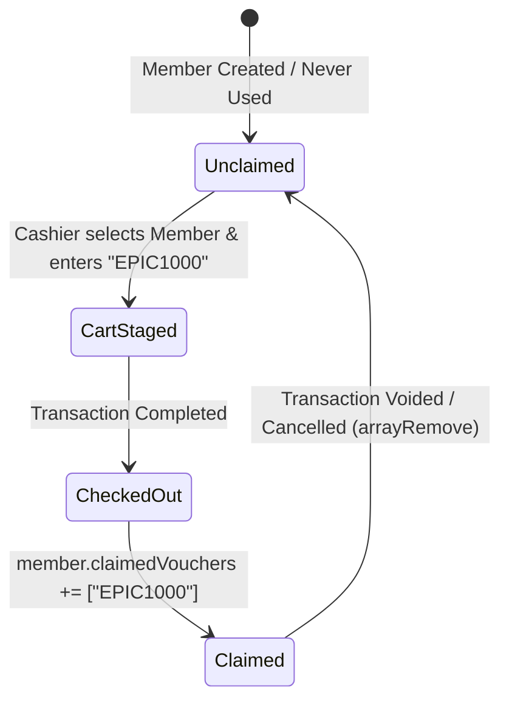

# Implementation Plan & Architecture Audit: EPIC1000 One-Time Member Voucher Code

## Status
- **Reviewer**: Independent System Architect & Reviewer
- **Audit Verdict**: **Approved with Critical Edge-Case Hardening**
- **Target Release**: Local Testing & Production Rollout

---

## 1. Executive Summary & Objective

Implement single-use promotional voucher code `EPIC1000` for gym members in the POS system:
- Locked pricing across 4 designated products.
- Once-per-member lifetime constraint (`2026-12-31T23:59:59.999Z` expiration).
- Single-item discount only (no stacking across quantity or multi-product purchases).
- Automatically applies to the eligible product giving the highest discount value.
- Handles pre-staged voucher entry (inputting voucher prior to selecting member or products).
- Automatic eligibility restoration upon transaction void.
- Resilient to Dexie offline/online state and reactive Dexie cache synchronization.

---

## 2. Independent Review & Audit Findings

The initial draft was thoroughly reviewed against the codebase (`CheckoutService`, `CartStore`, `DiscountService`, `MemberRepository`, `TransactionService`, and Dexie IndexedDB schemas). The following 5 critical architectural gaps were identified and corrected in this revised plan:

### 🔍 Finding 1: Split-Line Cart Architecture for Quantity > 1
- **Vulnerability**: In `CartStore`, products are stored as a single cart item with a `quantity` field:
  `subtotal = quantity * price`.
  If a member buys 2 Monthly Memberships (`quantity: 2`), applying `price: 1000` to the item would discount **both** units (saving ₱400 instead of ₱200).
- **Correction**: 
  Instead of mutating unit price directly across multiple units, we must split the calculation cleanly:
  `item.voucherDiscount = highestSaving` (applied once to line total).
  `item.subtotal = (item.quantity * item.originalPrice) - (item.voucherDiscount || 0)`.
  This guarantees that 1 unit is discounted and the rest remain at standard retail price without needing complex multi-line splits that could complicate barcode scanners or inventory decrements.

### 🔍 Finding 2: Commission Calculation Impact
- **Vulnerability**: In `CheckoutService.checkout()`, percentage-based staff commissions calculate from `item.subtotal`:
  `commissionAmount = Math.round(((item.subtotal || 0) * (commRate / 100)) * 100) / 100`.
- **Audit Check**: The 4 eligible products (`Monthly Membership`, `Monthly Membership w/ guidance`, `Personal Training 1 Month`, `Personal Training 1 Month Group`) currently use `commissionType: 'NONE'` or fixed rates. Using `item.subtotal` with `item.voucherDiscount` deducted ensures staff commissions (if configured as percentage) correctly reflect the actual revenue collected, avoiding overpayment of commission on discounted amounts.

### 🔍 Finding 3: Dexie Local Cache Invalidation for `member.claimedVouchers`
- **Vulnerability**: When checking out, `CheckoutService` updates Firestore `members/${memberId}` with `arrayUnion('EPIC1000')`. However, `MemberRepository` maintains an IndexedDB table `db.members`. If the local Dexie table is not updated immediately, a cashier in the same browser session could re-select the member before Firestore sync fires and bypass the check.
- **Correction**: Immediately update the local Dexie `members` record inside `MemberRepository` (or `CheckoutService`) alongside the Firestore write:
  ```typescript
  if (this.dbService.db) {
    const localMember = await this.dbService.db.members.get(memberId);
    if (localMember) {
      localMember.claimedVouchers = [...(localMember.claimedVouchers || []), voucherCode];
      await this.dbService.db.members.put(localMember);
    }
  }
  ```

### 🔍 Finding 4: Claim Voucher Dialog vs. Cart Input Workflow
- **Vulnerability**: The existing "🎁 Claim Voucher" button in POS opens `ClaimVoucherDialog`, which is wired to `fulfillRedemptionVoucher` (member coins redemption). If a cashier types `EPIC1000` there, the Firebase Function would fail with "Invalid or expired voucher code".
- **Correction**: 
  1. Add an interceptor inside `ClaimVoucherDialog.onFulfill()`: If input matches `EPIC1000`, close the dialog, return `{ type: 'PROMO_VOUCHER', code: 'EPIC1000' }`, and forward it to `pos.ts` to trigger `cartStore.applyVoucher('EPIC1000')`.
  2. Also add a dedicated, token-styled "Promo Code" input in the Cart column so cashiers can enter it directly without opening the modal.

### 🔍 Finding 5: Transaction Void / Cancellation Synchronization
- **Vulnerability**: When voiding a transaction via `TransactionService.voidTransaction()`, `arrayRemove('EPIC1000')` must be called on Firestore, but the local Dexie `members` record must also be synchronized so that the member's eligibility is immediately restored without requiring a full page refresh.
- **Correction**: Add local Dexie member update inside `TransactionService.voidTransaction()`.

---

## 3. Detailed Technical Specifications

### A. Voucher Matrix & Price Locks
| Product ID | Product Name | Original Price | Locked Promo Price | Member Savings |
| :--- | :--- | :--- | :--- | :--- |
| `Qfi33eVnbxN6kIPRTGbT` | Monthly Membership | ₱1,200 | **₱1,000** | ₱200 |
| `TKNm92Ekg87gub4eHCHO` | Monthly Membership (w/ guidance) | ₱2,200 | **₱2,000** | ₱200 |
| `GxNrhJR5CVSpnQuy4PwN` | Personal Training (1 Month) | ₱9,000 | **₱8,000** | **₱1,000** *(Highest)* |
| `kA3g2qW4jS1u235leAjK` | Personal Training (1 Month) (Group) | ₱4,600 | **₱4,000** | ₱600 |

### B. Highest-Value Single Discount Algorithm
Given active voucher `EPIC1000` and cart items $I_1, I_2, \dots, I_n$:
1. For each item $I_k$, determine eligibility:
   $$\text{saving}(I_k) = \begin{cases} \text{originalPrice}(I_k) - \text{lockedPrice}(I_k) & \text{if } I_k.\text{productId} \in \text{VoucherEligibleIds} \\ 0 & \text{otherwise} \end{cases}$$
2. Find item $I_{\text{best}}$ with $\max(\text{saving}(I_k))$. If maximum saving is 0, no discount applies.
3. Apply `voucherDiscount = saving(I_{\text{best}})` to $I_{\text{best}}$ only.
4. $I_{\text{best}}.\text{subtotal} = (I_{\text{best}}.\text{quantity} \times I_{\text{best}}.\text{originalPrice}) - I_{\text{best}}.\text{voucherDiscount}$.
5. All other items $I_{j \neq \text{best}}$ retain their standard calculation:
   $$I_j.\text{subtotal} = I_j.\text{quantity} \times I_j.\text{price}$$

### C. Member State Lifecycle


---

## 4. Step-by-Step Implementation Roadmap

### Phase 1: Models & TypeScript Definitions
- [ ] Add `claimedVouchers?: string[]` to `Member` in `src/app/core/models/member.model.ts`.
- [ ] Add `voucherDiscount?: number` and `appliedVoucherCode?: string` to `CartItem` in `src/app/core/models/store.model.ts`.
- [ ] Add `voucherCode?: string | null` and `voucherDiscountTotal?: number` to `Transaction` in `src/app/core/models/store.model.ts`.

### Phase 2: Discount Service & Evaluation Engine
- [ ] In `src/app/core/services/discount.service.ts`:
  - Define `PROMO_VOUCHERS` dictionary for `EPIC1000` (price locks, expiration `2026-12-31T23:59:59.999Z`, eligible product map).
  - Add `validatePromoVoucher(code: string, member: Member | null): { valid: boolean; error?: string }`.
  - Add `evaluateVoucherForCart(items: CartItem[], code: string | null): { items: CartItem[]; totalVoucherDiscount: number; appliedProductId: string | null }`.

### Phase 3: CartStore Reactive State
- [ ] In `src/app/core/store/cart.store.ts`:
  - Add `activeVoucherCode: signal<string | null>(null)` to `CartState`.
  - Add methods `applyVoucher(code: string)` and `removeVoucher()`.
  - Integrate voucher evaluation across `addItem`, `updateQuantity`, `removeItem`, and `setMember`.
  - Handle pre-staged voucher retention when items are added later.

### Phase 4: POS UI & Dialog Enhancements
- [ ] In `claim-voucher-dialog.ts`: Intercept `EPIC1000` to prevent calling cloud function and instead emit back to POS.
- [ ] In `pos.html` & `pos.ts`:
  - Add "Apply Promo Code" field in the Cart summary column.
  - Display applied voucher chip `[🏷️ EPIC1000: -₱X,XXX ✕]` with a remove button.
  - Show intuitive helper status when voucher is staged before products are added:
    > *"EPIC1000 applied: Add an eligible Membership or PT package to claim discount."*
  - Guard check on checkout: Verify member is selected.

### Phase 5: Checkout Batch & Void Restoration
- [ ] In `CheckoutService.checkout()`:
  - Add `claimedVouchers: arrayUnion(voucherCode)` to Firestore member doc batch.
  - Update local Dexie member record optimistically.
  - Persist `voucherCode` and `voucherDiscountTotal` on the transaction document.
- [ ] In `TransactionService.voidTransaction()`:
  - If transaction has `voucherCode`, execute `arrayRemove(voucherCode)` on Firestore member doc batch.
  - Update local Dexie member record to remove the voucher code.

### Phase 6: Automated Verification & Audit
- [ ] Write unit tests for `DiscountService.validatePromoVoucher` and `CartStore` single-item/highest-discount calculations.
- [ ] Run Angular compilation (`compile_applet`) to ensure zero TypeScript/template errors.
- [ ] Perform change safety audit against existing systems (cash register shifts, commissions, inventory logs).
