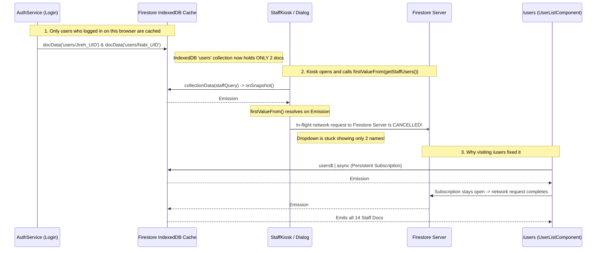

# Implementation Plan: Fix Missing Staff Names in Clock-In/Out Dropdown (IndexedDB Local Cache + `firstValueFrom` Race Condition)

## 1. Problem Statement & User Observations

### Symptoms Reported by User
1. *"In clock-in/out, the staffs are missing... one by one... only one staff name was missing before... now 2 names does not load in the dropdown of names..."*
2. *"Still 2 names... only the staff/users who logged in..."*
3. *"It seems the Staff Directory or `/users` page needs to load first before the names show in this dropdown."*

---

## 2. Deep Root Cause Analysis

### Why Only Logged-In Users Appeared (Until `/users` Was Visited)

The root cause is a classic interaction between **Firestore's `persistentLocalCache` (IndexedDB)**, **`collectionData()` (`onSnapshot`)**, and **RxJS `firstValueFrom()`**:



### Step-by-Step Breakdown of the Bug

1. **Firestore IndexedDB Persistence (`src/app/app.config.ts`)**:
   - The app initializes Firestore with:
     ```typescript
     localCache: persistentLocalCache({ tabManager: persistentMultipleTabManager() })
     ```
2. **How Individual Users Enter the Local Cache (`src/app/core/services/auth.service.ts`)**:
   - Whenever a user logs into the app on a browser (`Jireh Padua` and `Nabi Sai` on `localhost:4200`), `AuthService` fetches `docData(doc(this.firestore, 'users', user.uid))`.
   - This caches **only that logged-in user's document** inside the browser's IndexedDB `users` collection.
   - Staff who only clock in/out via the Kiosk (which verifies passwords using a secondary in-memory Auth app `kioskAuthApp` without logging into the main app) never have their `users/{uid}` document individually fetched on login.
   - Over time on the Kiosk browser, as individual cached user documents were evicted by IndexedDB's LRU garbage collector (or when staff didn't log into the main app), staff names disappeared **one by one** from the local cache.
3. **The Fatal `firstValueFrom(collectionData(...))` Call**:
   - In `StaffKioskDialogComponent` (`staff-kiosk-dialog.ts:139`) and `StaffKioskComponent` (`staff-kiosk.ts:166`):
     ```typescript
     const users = await firstValueFrom(this.userService.getStaffUsers());
     this.staffList.set((users || []).filter(u => u.isActive !== false));
     ```
   - `userService.getStaffUsers()` uses `collectionData()`, which wraps Firestore's real-time `onSnapshot()`.
   - When `persistentLocalCache` is enabled, `onSnapshot()` **immediately and synchronously emits a cached snapshot (`fromCache: true`)** containing whatever subset of matching documents already exists in local IndexedDB (the 2 logged-in users).
   - `firstValueFrom()` takes **only the first emission (`take(1)`)** and **immediately unsubscribes**!
   - Unsubscribing tears down the `onSnapshot` listener before Firestore can complete the network round-trip to the server. Thus, the remaining staff documents on the server are never fetched!
4. **Why Visiting `/users` (Staff Directory) Made the Names Appear**:
   - `UserListComponent` (`/users`) binds `users$ = this.userService.getStaffUsers()` using Angular's `| async` pipe (a **persistent subscription**, not `firstValueFrom()`).
   - When `/users` loads, it receives Emission #1 (the 2 cached docs), **stays subscribed**, and ~150ms later receives Emission #2 from the Firestore Server containing all 14 staff documents—which Firestore then writes into IndexedDB.
   - Once `/users` populated IndexedDB, opening the Kiosk dropdown worked until the cache became stale or evicted entries again.

---

## 3. Comprehensive Audit of Affected Components

We audited all occurrences of `getStaffUsers()` and `getShiftDefinitions()` across the entire codebase:

| File | Current Pattern | Vulnerable to Partial Cache? |
|------|-----------------|------------------------------|
| `src/app/core/services/user.service.ts` | `getStaffUsers()` uses `collectionData()` | Needs `getStaffUsersOnce()` using `getDocs()` + server-side filter |
| `src/app/features/dashboard/widgets/staff-kiosk-widget/staff-kiosk-dialog.ts` | `await firstValueFrom(this.userService.getStaffUsers())` | **YES (Bug in screenshot 1)** |
| `src/app/features/staff-attendance/components/staff-kiosk/staff-kiosk.ts` | `await firstValueFrom(this.userService.getStaffUsers())` | **YES (Bug in screenshot 2)** |
| `src/app/features/staff-attendance/pages/staff-attendance-admin/staff-attendance-admin.ts` | `await firstValueFrom(this.userService.getStaffUsers())` | **YES (Weekly payroll report missing staff if `/users` not loaded first)** |
| `src/app/features/audit-log/audit-log.ts` | `await firstValueFrom(this.userService.getStaffUsers())` | **YES (Audit log staff filter missing staff if `/users` not loaded first)** |
| `src/app/features/shift-schedules/pages/shift-schedules/shift-schedules.ts` | `.subscribe(users => ...)` | Safe (persistent subscription) |
| `src/app/features/user-management/components/user-list/user-list.component.ts` | `users$ \| async` | Safe (persistent subscription) |

Additionally, `shiftScheduleService.getShiftDefinitions()` is also called with `firstValueFrom()` in `staff-kiosk-dialog.ts` and `staff-kiosk.ts`, which has the same local-cache-first behavior.

---

## 4. Proposed Solution

### Step 1: Add `getStaffUsersOnce()` in `UserService` Using `getDocs()`
- In `src/app/core/services/user.service.ts`:
  - Add an explicit `async getStaffUsersOnce(): Promise<User[]>` method that uses Firestore's `getDocs(staffQuery)` instead of `collectionData()`.
  - Unlike `firstValueFrom(collectionData())`, `getDocs(query)` **always awaits the authoritative server response** when online (and populates the local IndexedDB cache with the full result set), falling back to IndexedDB cache only if the device is offline.
  - Keep `getStaffUsers(): Observable<User[]>` with `collectionData(staffQuery)` for real-time streams.

```typescript
/**
 * Fetches all internal staff users once directly from Firestore (server-first with offline fallback).
 * Avoids the partial local-cache emission race condition caused by firstValueFrom(collectionData()).
 */
async getStaffUsersOnce(): Promise<User[]> {
    const usersCol = collection(this.firestore, 'users');
    const staffQuery = query(
        usersCol,
        where('roles', 'array-contains-any', STAFF_ROLES)
    );
    const snapshot = await getDocs(staffQuery);
    const users = snapshot.docs.map(d => ({ ...(d.data() as User), uid: d.id }));
    return users
        .filter(user => this.isStaffUser(user))
        .sort((a, b) => (a.displayName || '').localeCompare(b.displayName || ''));
}
```

### Step 2: Add `getShiftDefinitionsOnce()` in `ShiftScheduleService` Using `getDocs()`
- In `src/app/core/services/shift-schedule.service.ts`:
  - Add `async getShiftDefinitionsOnce(): Promise<ShiftDefinition[]>` using `getDocs(this.shiftsCol)` so the Kiosk always gets the full server shift definitions without aborting on an empty initial cache emission.

### Step 3: Update Kiosk Components & Admin Consumers
1. **`StaffKioskDialogComponent` (`staff-kiosk-dialog.ts`)**:
   - Subscribe to `this.userService.getStaffUsers()` via a managed `Subscription` (for instant cache display + live updates) AND call `await this.userService.getStaffUsersOnce()` in `loadData()` to guarantee all active staff are loaded immediately on first open even if `/users` was never visited.
   - Replace `firstValueFrom(this.shiftScheduleService.getShiftDefinitions())` with `await this.shiftScheduleService.getShiftDefinitionsOnce()`.
2. **`StaffKioskComponent` (`staff-kiosk.ts`)**:
   - Subscribe to `this.userService.getStaffUsers()` via a managed `Subscription` AND call `await this.userService.getStaffUsersOnce()` in `loadKioskData()`.
   - Replace `firstValueFrom(this.shiftScheduleService.getShiftDefinitions())` with `await this.shiftScheduleService.getShiftDefinitionsOnce()`.
3. **`StaffAttendanceAdminComponent` (`staff-attendance-admin.ts`)**:
   - Replace `await firstValueFrom(this.userService.getStaffUsers())` with `await this.userService.getStaffUsersOnce()`.
4. **`AuditLogComponent` (`audit-log.ts`)**:
   - Replace `await firstValueFrom(this.userService.getStaffUsers())` with `await this.userService.getStaffUsersOnce()`.

### Step 4: Ensure `createStaffAccount` Cloud Function Sets `isActive: true`
- In `functions/src/index.ts`, ensure newly created staff documents explicitly include `isActive: true` on creation so every staff record has a consistent schema.

---

## 5. Verification Plan
- [x] Verify that opening `localhost:4200/dashboard` -> **Clock In / Out** or `localhost:4200/staff-kiosk` on a fresh session (without visiting `/users` first) immediately loads all 6 active staff members (`Aljay Tindoy`, `Angelito Miranda`, `Jireh Padua`, `Kris Ragam Manuel`, `Lauren Val Manuel`, `Nabi Sai`).
- [x] Run `npm run build` and `npm run build:members` to verify zero compilation errors.
- [x] Commit implementation plan and code fixes to Git.
