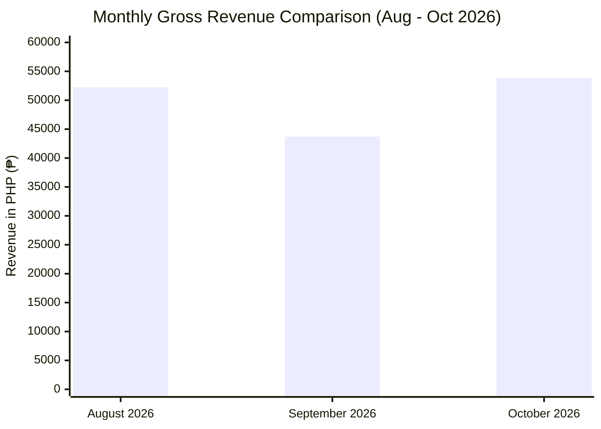

# Executive Financial & Operational Performance Audit: October 2026
**Comparative Analysis: August 2026 vs. September 2026 vs. October 2026**  
**Prepared Date**: November 1, 2026  
**Data Source**: Live Production Firestore (`transactions`, `attendance`, `members`, `products`)  
**Scope Note**: *Gross Inflows, Product Mix, Attendance, New Member Acquisition, Loyalty, and 30-Day Renewal/Churn. (Expenses/Outflows are excluded per scope constraint).*

---

## 1. Executive Summary & Scorecard

October 2026 achieved **the highest gross revenue in the last 3 months at ₱53,870**, rebounding **+23.27% (+₱10,170)** from September's dip (₱43,700) and surpassing August's peak (₱52,240 by +3.12%).

However, **how** the gym earned its money in October has fundamentally shifted compared to August:
- **August (Volume-Driven Model)**: High foot traffic (597 check-ins, 141 unique visitors, 244 walk-ins at ₱70 promo rate) with lower ticket sizes (₱163.76/tx).
- **October (Yield-Driven Core Model)**: Smaller, ultra-dedicated core member base (443 check-ins, 70 unique visitors, **6.30 visits/member/month**), higher pricing power (₱1,000–₱1,200 standard membership, ₱150 walk-in), and a **record ₱441.56 average transaction ticket (+39.4% MoM)**.

| Key Performance Indicator (KPI) | August 2026 | September 2026 | October 2026 | Oct vs. Sep (MoM) | Oct vs. Aug (2-Mo) | Status / Verdict |
| :--- | :---: | :---: | :---: | :---: | :---: | :--- |
| **Gross Revenue (Valid Sales)** | ₱52,240 | ₱43,700 | **₱53,870** | **+23.27%** (+₱10,170) | **+3.12%** (+₱1,630) | 🟢 **Performing Well (3-Mo High)** |
| **Completed Transactions** | 319 | 138 | **122** | -11.59% (-16 txs) | -61.76% (-197 txs) | 🟡 Lower Tx Count, Higher Value |
| **Average Ticket Size (AOV)** | ₱163.76 | ₱316.67 | **₱441.56** | **+39.44%** (+₱124.89) | **+169.64%** (+₱277.80) | 🟢 **Strong Pricing Power** |
| **Membership & Coaching Revenue** | ₱31,400 (60.1%) | ₱23,400 (53.5%) | **₱36,100 (67.0%)** | **+54.27%** (+₱12,700) | **+14.97%** (+₱4,700) | 🟢 **Core Recurring Engine** |
| **Personal Training (Group PT)** | ₱0 (0.0%) | ₱9,200 (21.1%) | **₱9,200 (17.1%)** | 0.00% (Flat) | +100% (+₱9,200) | 🟡 Concentrated in 1 Client |
| **Daily Walk-In Revenue** | ₱17,010 (244 pax) | ₱7,350 (50 pax) | **₱5,850 (39 pax)** | -20.41% (-11 pax) | -65.61% (-205 pax) | 🔴 **Lacking (Top-of-Funnel Drop)** |
| **Supplements & Drinks Revenue** | ₱3,830 (7.3%) | ₱3,750 (8.6%) | **₱2,720 (5.0%)** | **-27.47%** (-₱1,030) | **-28.98%** (-₱1,110) | 🔴 **Lacking ( declining attach rate)** |
| **Voided Transactions** | 8 (₱580) | 4 (₱610) | **5 (₱4,780)** | +683.6% Void Value | +724.1% Void Value | 🟠 Operational Checkout Friction |
| **Total Check-Ins (Raw / Unique Day)** | 597 / 587 | 448 / 446 | **443 / 441** | -1.12% (-5 visits) | -25.80% (-154 visits) | 🟡 Stabilized Floor Traffic |
| **Unique Active Gym Visitors** | 141 | 75 | **70** | -6.67% (-5 visitors) | -50.35% (-71 visitors) | 🔴 **Shrinking Active Member Pool** |
| **Attendance Frequency (Visits/User)** | 4.16 days/mo | 5.95 days/mo | **6.30 days/mo** | **+5.88%** | **+51.44%** | 🟢 **High Core Habit Formation** |
| **New Member Registrations** | 60 profiles | 21 profiles | **21 profiles** (19 net) | 0.00% (Flat) | -65.00% (-39 profiles) | 🟡 Acquisition Volume Low |
| **New Member -> Monthly Conversion** | 21.7% (13/60) | 28.6% (6/21) | **38.1% (8/21)** | **+9.5 pts** | **+16.4 pts** | 🟢 **Closing Efficiency Improving** |
| **30-Day Cohort Renewal Rate** | 43.2% (On-Time) | 70.8% (On-Time) | **70.8%** (17/24 active) | **+27.6 pts vs Aug** | — | 🟢 **Strong Core Retention** |

---

## 2. Revenue & Sales Deep-Dive (Aug vs. Sep vs. Oct)

### 2.1 Revenue Mix by Stream

````carousel

<!-- slide -->

```mermaid
xychart-beta
    title "Revenue Breakdown by Stream (Aug vs Sep vs Oct)"
    x-axis ["Memberships & Guidance", "Group Personal Training", "Daily Walk-Ins", "Drinks & Supplements"]
    y-axis "Revenue in PHP (₱)" 0 --> 40000
    bar [31400, 0, 17010, 3830]
    bar [23400, 9200, 7350, 3750]
    bar [36100, 9200, 5850, 2720]
```

````

| Revenue Stream | August 2026 | September 2026 | October 2026 | Share of Oct Sales | 3-Month Trend Analysis |
| :--- | :---: | :---: | :---: | :---: | :--- |
| **1. Standard Monthly Memberships** | ₱22,400 (32 units) | ₱17,000 (22 units) | **₱28,000 (34 units)** | **51.98%** | **Record high in October.** Driven by 26 renewals/win-backs + 6 new joiners + 2 returning legacy members, plus higher realized unit pricing (₱823.53 avg vs ₱700 in Aug). |
| **2. Group Personal Training (1 Mo)** | ₱0 (0 units) | ₱9,200 (2 units) | **₱9,200 (2 units)** | **17.08%** | High-ticket stabilizer (₱4,600/unit), **but 100% purchased by a single VIP client** (`ma. angelene ibanez`), creating concentration risk. |
| **3. Monthly Membership w/ Guidance** | ₱9,000 (6 units) | ₱2,200 (1 unit) | **₱8,100 (4 units)** | **15.04%** | Rebounded strongly in Oct (4 units sold to Maricar Tumbokon, Beloved Padua, Angelica Reyes, Angeline Reyes). Price increased from ₱1,500 to ₱2,200. |
| **4. 6-Month Gym Membership** | ₱0 (0 units) | ₱4,200 (1 unit) | **₱0 (0 units)** | **0.00%** | 1 sold in Sep (Ricardo Bautista Jr.); 0 sold in Oct. Multi-month commitments remain largely untapped. |
| **5. Daily Walk-Ins** | ₱17,010 (244 units) | ₱7,350 (50 units) | **₱5,850 (39 units)** | **10.86%** | **Steep 3-month contraction.** After raising walk-in price from ₱70 (Aug) to ₱150 (Sep/Oct), volume dropped **-84%** (244 -> 39) and revenue fell **-65.6%** (-₱11,160). |
| **6. Supplements & Drinks** | ₱3,830 (65 units) | ₱3,750 (79 units) | **₱2,720 (59 units)** | **5.05%** | **Down -27.5% MoM.** Zero protein tub/pouch sales since Aug, and protein drink volume fell from 25 cups (Sep) to 17 cups (Oct). |
| **TOTAL GROSS REVENUE** | **₱52,240** | **₱43,700** | **₱53,870** | **100.00%** | **+23.27% MoM / +3.12% vs. August** |

### 2.2 Payment Methods, Voids & Pacing Dynamics
1. **Digital Payment Shift (GCash Overtakes Cash)**:
   - **August**: Cash 66.3% (₱34,660) | GCash 33.7% (₱17,580)
   - **September**: Cash 52.4% (₱22,905) | GCash 47.6% (₱20,795)
   - **October**: Cash 41.6% (₱22,430) | **GCash 58.4% (₱31,440)** *(including ₱5,100 across Split payments)*
   - *Insight*: Nearly 60% of revenue now flows through GCash. Ensuring strict GCash reference number verification is critical.
2. **Spike in Voided Transaction Value (₱4,780 across 5 Voids in October)**:
   - Most October voids occurred because staff rang up transactions as **Cash** instead of **GCash** or at the old price vs. new price (e.g., Beloved Padua had ₱1,500 and ₱2,200 voided on Oct 5 before settling on ₱1,500; Bert Banico ₱700 voided on Oct 22 for `"gcash"`; Gilbert Ibanez ₱360 voided on Oct 30 for `"gcash"`).
3. **Extreme Front-Loaded Revenue Pacing**:
   - **First 9 Days of October (Oct 1–9)**: Generated **₱30,570 (56.7% of the entire month's revenue)**, peaking on Friday, Oct 9 at **₱13,000**.
   - **Mid-Month Lull (Oct 10–15)**: Averaged just **₱296/day** (dropping to ₱20 on Sunday, Oct 11 and ₱60 on Thursday, Oct 15).
   - **Day-of-Week Performance (October)**:
     - **Fridays (₱18,140)**, **Wednesdays (₱10,430)**, and **Mondays (₱10,020)** generated **71.6%** of October revenue.
     - **Thursdays (₱2,610)** and **Sundays (₱3,220)** were the weakest revenue days.

### 2.3 Staff Sales Attribution
| Staff Member | August 2026 | September 2026 | October 2026 | Oct Share (%) | Avg Ticket (Oct) |
| :--- | :---: | :---: | :---: | :---: | :---: |
| **Aljay Tindoy** | ₱2,950 (23 txs) | ₱26,020 (70 txs) | **₱23,830 (37 txs)** | **44.24%** | **₱644.05** |
| **Lauren Val Manuel** | ₱26,640 (135 txs) | ₱9,280 (32 txs) | **₱17,060 (51 txs)** | **31.67%** | ₱334.51 |
| **Kris Ragam Manuel** | ₱7,660 (70 txs) | ₱7,700 (33 txs) | **₱12,980 (34 txs)** | **24.09%** | ₱381.76 |

---

## 3. Product Sales Performance Audit

### 3.1 Active Movers (Aug – Oct 2026)
Out of **26 products** in the POS catalog, **only 7 products generated any sales in October** (down from 9 in August and September).

| Product Name | Category | Catalog Price | Current Stock | Aug Qty (Rev) | Sep Qty (Rev) | Oct Qty (Rev) | MoM Rev Change | Performance Verdict |
| :--- | :---: | :---: | :---: | :---: | :---: | :---: | :---: | :--- |
| **Monthly Membership** | Training | ₱1,200 *(₱700/₱1,000 legacy/student)* | 862 | 32 (₱22,400) | 22 (₱17,000) | **34 (₱28,000)** | **+64.7%** | ⭐ **#1 Flagship Driver** |
| **Personal Training (1 Mo Group)** | Training | ₱4,600 | 90 | 0 (₱0) | 2 (₱9,200) | **2 (₱9,200)** | 0.0% | 🟢 High Margin, Low Breadth |
| **Monthly Membership (w/ guidance)** | Training | ₱2,200 | 46 | 6 (₱9,000) | 1 (₱2,200) | **4 (₱8,100)** | **+268.2%** | 🟢 Strong Upsell Tier |
| **Daily Walk-in** | Training | ₱150 | 56 | 244 (₱17,010) | 50 (₱7,350) | **39 (₱5,850)** | **-20.4%** | 🔴 Volume Eroding Rapidly |
| **Whey Protein Drinks + Creatine** | Drinks | ₱120 | 78 | 2 (₱180) | 10 (₱1,200) | **9 (₱1,080)** | -10.0% | 🟢 Best Combo Beverage |
| **Creatine (1 scoop)** | Drinks | ₱20 | 723 | 38 (₱760) | 54 (₱1,080) | **42 (₱840)** | -22.2% | 🟡 Steady Add-on (9.5% attach) |
| **Whey Protein Drinks** | Drinks | ₱100 | 72 | 22 (₱1,540) | 11 (₱1,070) | **8 (₱800)** | **-25.2%** | 🔴 Down 64% since August |
| **Whey Protein Drinks + Milk** | Drinks | ₱130 | 81 | 1 (₱100) | 4 (₱400) | **0 (₱0)** | **-100.0%** | 🔴 Stalled in October |
| **6-Month Gym Membership** | Training | ₱4,900 | 98 | 0 (₱0) | 1 (₱4,200) | **0 (₱0)** | **-100.0%** | 🟠 Untapped Cashflow Lever |

### 3.2 Dormant & Zero-Sale Catalog (19 of 26 Products = 0 Sales in Oct)
- **Zero-Sale High-Ticket Services**:
  - `Personal Training (1 Month)` (₱9,000) — **0 sold in 3 months**
  - `Personal Training (1 Session)` (₱800) — **0 sold in 3 months**
  - `Boxing (1 Month)` (₱6,400), `Boxing (1 Month w/ Group)` (₱4,800), `Boxing (1 session)` (₱500) — **0 sold in 3 months**
  - `3-Month Gym Membership` (₱3,000) — **0 sold in 3 months**
  - `Circuit Training` (₱200) — **0 sold in 3 months**
- **Zero-Sale Retail & Drinks**:
  - `Coffee + Stevia` (₱15, 18 in stock), `Milk (3 scoops)` (₱30, 13 in stock), `Whey + Creatine + Milk` (₱150, 74 in stock).
  - `Whey Protein (5 lbs)` (₱3,400, 2 in stock), `Whey Protein (1lb)` (₱1,200, 1 in stock), `Creatine (300g)` (₱1,000, 1 in stock), `Shirataki Rice` (₱350 set / ₱50 pc).
- **Beverage Attach Rate Calculation**:
  - Out of **443 gym check-ins** in October, only **17 protein drinks** (3.8% of visits) and **42 creatine scoops** (9.5% of visits) were sold. Total beverage revenue per check-in dropped from **₱8.37/visit in Sep** to **₱6.14/visit in Oct (-26.6%)**.

---

## 4. Attendance & Foot Traffic Analysis

| Attendance Metric | August 2026 | September 2026 | October 2026 | Oct vs. Sep | Oct vs. Aug |
| :--- | :---: | :---: | :---: | :---: | :---: |
| **Total Check-Ins (Raw)** | 597 | 448 | **443** | -1.12% | -25.80% |
| **Unique Daily Visits (Deduplicated)** | 587 | 446 | **441** | -1.12% | -24.87% |
| **Unique Individual Visitors** | 141 | 75 | **70** | **-6.67%** | **-50.35%** |
| **Avg Visits per Unique Member** | 4.16 days | 5.95 days | **6.30 days** | **+5.88%** | **+51.44%** |
| **Weekday Check-Ins (Mon–Fri)** | 453 (76.3%) | 344 (76.8%) | **348 (78.6%)** | +1.16% | -23.18% |
| **Weekend Check-Ins (Sat–Sun)** | 141 (23.7%) | 104 (23.2%) | **95 (21.4%)** | **-8.65%** | -32.62% |
| **Gender Split (Male / Female)** | 77.1% M / 22.3% F | 80.8% M / 19.2% F | **79.7% M / 20.3% F** | +1.1 pts Female | -2.0 pts Female |

### Key Traffic & Capacity Findings
1. **The "70-Member Core" Phenomenon**:
   - While total monthly check-ins held steady between September (448) and October (443), the number of unique visitors shrank from **141 in August -> 75 in September -> 70 in October**.
   - Essentially, walk-in casual traffic vanished after the August promo ended, leaving a concentrated core of 70 members who work out an average of **6.3 days/month** (and the top 25 work out **8 to 25 days/month**).
2. **Hourly Rush vs. Lull Distribution (October)**:
   - **Evening Peak (5:00 PM – 8:59 PM)**: **263 check-ins (59.4% of all daily traffic)** occur in a 4-hour window (`19:00` is #1 with 83 check-ins, `17:00` #2 with 69, `20:00` #3 with 64, `18:00` #4 with 47).
   - **Morning & Midday Dead Zone (7:00 AM – 2:59 PM)**: An 8-hour span accounts for only **99 check-ins total (22.3% of traffic, or ~0.4 check-ins per hour)**. `09:00` had only 6 check-ins all month; `12:00` had only 7.
3. **Weekend Slump**:
   - Sunday check-ins fell notably (e.g., Sunday Oct 11 had only **3 check-ins**; Oct 25 and Oct 29 had **7 check-ins**).

---

## 5. Loyal Members Analysis (Consistency, Attendance & Spend)

### 5.1 Top 15 Most Loyal Attendees in October 2026 (Plus 3-Month Consistency)
**34 core members** have checked in consistently across **all three consecutive months (August, September, and October)**. Below are the top 15 champions driving gym culture:

| Rank | Member Name | Oct Unique Days | Sep Days | Aug Days | 3-Mo Total Days | Oct Spend (₱) | Membership Expiration | Status / Action |
| :---: | :--- | :---: | :---: | :---: | :---: | :---: | :---: | :--- |
| **1** | **Jerry Bagasala** | **25 days** | 21 | 4 | 50 days | ₱890 | 2026-11-29 | 🏆 **#1 Oct Attendance Leader** |
| **2** | **Louie Bautista** | **22 days** | 21 | 20 | **63 days** | ₱840 | 2026-12-01 | 🏆 **#1 3-Month Ironman (21d/mo avg)** |
| **3** | **Ray Santos** | **21 days** | 8 | 0 | 29 days | ₱1,200 | 2026-11-26 | ⭐ Rising Star (Joined Sep 20) |
| **4** | **Ryan Christian Cuevas** | **18 days** | 21 | 16 | **55 days** | ₱740 | 2026-11-06 | 🔔 Renewing Nov 6 |
| **5** | **Rolex M. Ramel** | **18 days** | 16 | 6 | 40 days | ₱700 | 2026-12-30 | 🟢 Pre-paid through Dec 30 |
| **6** | **Romeo Jr Rosales Santiago** | **17 days** | 12 | 16 | **45 days** | ₱1,160 | 2026-11-23 | 🟢 High Creatine & Drink buyer |
| **7** | **Maricar Tumbokon** | **15 days** | 12 | 15 | **42 days** | ₱2,200 | 2026-11-06 | 💎 VIP (Guidance Tier + High Attendance) |
| **8** | **Ronaldo Montaos** | **13 days** | 14 | 10 | 37 days | ₱940 | 2026-11-28 | 🟢 Steady 3-Month Regular |
| **9** | **Derek Justin Canilao** | **12 days** | 15 | 11 | 38 days | ₱1,420 | 2026-11-10 | 💎 High Drink/Supplement Buyer (8 txs) |
| **10** | **Frimato Padilla** | **12 days** | 13 | 0 | 25 days | ₱1,200 | 2026-11-03 | 🔔 Renewing Nov 3 |
| **11** | **Christian Q. Navarro** | **12 days** | 11 | 1 | 24 days | ₱880 | 2026-11-04 | 🔔 Renewing Nov 4 |
| **12** | **Asher Delpilar** | **11 days** | 14 | 6 | 31 days | ₱700 | 2026-11-05 | 🔔 Renewing Nov 5 |
| **13** | **Richelle Lopez** | **11 days** | 7 | 11 | 29 days | ₱820 | 2026-11-20 | 🟢 Consistent Female Regular |
| **14** | **Venz Mingollo** | **11 days** | 11 | 16 | 38 days | ₱200 | **2026-10-21** | ⚠️ **EXPIRED OCT 21 (Urgent Renewal!)** |
| **15** | **Paul Abadilla** | **11 days** | 2 | 0 | 13 days | ₱0 (Paid Sep 28) | **2026-10-28** | ⚠️ **EXPIRED OCT 28 (Urgent Renewal!)** |

### 5.2 Top Revenue Contributors (VIP Spenders — Aug to Oct)
1. **Ma. Angelene Ibanez**: **₱9,660 in Oct** (₱5,670 in Sep) — Purchased 2x Group Personal Training (₱9,200) + Protein/Creatine drinks. *Single-handedly accounts for 17.9% of October's total revenue.*
2. **Maricar Tumbokon**: **₱2,200 in Oct** (₱3,000 in Aug) — Monthly Membership w/ Guidance + 15 gym visits/mo.
3. **Angelica Reyes & Angeline Reyes**: **₱2,200 each in Oct** — Both purchased Monthly Membership w/ Guidance.
4. **Beloved Padua**: **₱1,500 in Oct** (₱1,640 in Aug) — Monthly Membership w/ Guidance.
5. **Pamela Riego**: **₱1,500 in Oct** — Started with 2 walk-ins (₱300) on Oct 9 & Oct 24, then converted to a ₱1,200 Monthly Membership on Oct 28.
6. **Derek Justin Canilao**: **₱1,420 in Oct** (₱1,550 in Aug) — Monthly Membership + frequent post-workout Whey/Creatine drinks.

---

## 6. New Member Acquisition & Conversion Funnel

| Acquisition Metric | August 2026 | September 2026 | October 2026 | 3-Month Trend & Diagnosis |
| :--- | :---: | :---: | :---: | :--- |
| **Gross New Profiles Created** | 60 | 21 | **21** *(19 unique people)* | **-65% drop from Aug; flat vs. Sep.** *(Note: 2 duplicate profiles created in Oct).* |
| **Converted to Monthly Membership** | 13 (**21.7%**) | 6 (**28.6%**) | **8 (38.1% / 42.1% net)** | 🟢 **Conversion rate nearly doubled** (from 21.7% -> 38.1%). |
| **Walk-In Only (Did Not Subscribe)** | 37 (61.7%) | 14 (66.7%) | **10 (47.6%)** | 🟡 10 walk-in prospects in Oct tried the gym 1–3 times (`Jacob Antonio` 3x, `Karina Javier` 2x, `Arthur Camillo` 2x) but were not closed into a monthly plan. |
| **Zero-Transaction Profiles** | 9 (15.0%) | 1 (4.8%) | **3 (14.3%)** | 🔴 Includes duplicate records (`Ezra Agustin`, `Hannah Grace Laguda`) and profiles with no linked POS sale (`Cristal Ancero`, `Mark Gawing`). |
| **Revenue from New Cohort** | ₱33,340 | ₱13,420 | **₱13,930** | Flat MoM (+3.8% vs Sep). |

### Data Hygiene Issues Discovered in October New Members
1. **Duplicate Member Profiles Created in October**:
   - **Hannah Grace Laguda**: Created on `2026-10-06` (`BnvruGOc3NLzSmqg3yHA`, Walk-in ₱150, marked Inactive) and created **again** on `2026-10-09` (`1nZiAOapXL14LMwWyodU`, Monthly Membership ₱1,000, Active).
   - **Ezra Agustin**: Created **twice** on `2026-10-12` (`j6s0DOk9WQEahjAqk4Fm` and `qxNtskGv17h09rg95D43`).
   - **Adrian L. Mendoza**: Created on `2026-10-02` (`yBKQDwbhURX4t6oqoLq8`, 2 walk-ins ₱300) and created **again** in ALL CAPS on `2026-10-21` (`hTMrgPLCCfTTox87Hy2D`, Monthly Membership ₱1,000).
   - *Impact*: Splitting walk-ins and memberships across duplicate profiles breaks member visit streaks and inflates new member counts.
2. **Missing Expiration Dates on Paid Memberships**:
   - **Angeline Reyes** (`UMZTksizaMx3OeXJ6G8o`) paid **₱2,200** for `Monthly Membership (w/ guidance)` on `2026-10-26`, but her `membershipExpiration` field in Firestore is **blank (`""`)**.
   - **Jacob Antonio** (`UUDJLOu8X2suGIEwUQAn`) has `membershipExpiration: 2026-11-28`, but only 3 walk-in transactions (₱600) are linked to his ID.

---

## 7. Retention & Churn Analysis: Members Who Did Not Renew Within 30 Days

To give you complete visibility, we analyzed **both** the cohort renewal rates and the exact roster of members whose subscriptions lapsed without renewal.

### 7.1 Cohort Renewal Comparison (August vs. September vs. October)
1. **August Membership Cohort (37 unique buyers whose 30-day plans expired in September)**:
   - **16 (43.2%)** renewed on time within 30 days in September.
   - **10 (27.0%)** skipped 1–3 weeks and renewed in early October (*"Late Renewers"*, e.g., Maricar Tumbokon, Asher Delpilar, Christian Navarro, Derek Canilao, Adrian Canilao, Beloved Padua, Richelle Lopez, Mark Mayacyac).
   - **11 (29.7%)** **never renewed** (>30 days lapsed).
2. **September Membership Cohort (24 unique buyers whose plans expired in October)**:
   - **16 (66.7%)** renewed on time in October.
   - **1 (4.2%)** is on an active 6-Month Membership (Ricardo Bautista Jr., valid to Feb 2027).
   - **1 (4.2%)** has an extended expiration date (Chuck Hendrix Pingol).
   - **6 (25.0%)** expired in October and have not renewed yet (plus 3 late-August buyers whose Sept 30 / Oct 1 expirations crossed into October, totaling **9 October expirations**).

---

### 7.2 Group A: Unrenewed > 30 Days (Expired in September / Late August — Critical Churn Roster)
These **10 members** had active memberships that expired between **September 19 and October 1, 2026**. More than **30 days have elapsed** as of November 1, 2026 without renewal. *(Total lost recurring revenue: **~₱7,800/month**).*

| # | Member Name | Contact Number | Expiration Date | Days Lapsed | Aug Visits | Sep Visits | Oct Visits | Churn Diagnosis & Win-Back Priority |
| :---: | :--- | :---: | :---: | :---: | :---: | :---: | :---: | :--- |
| 1 | **Romeo Alto III** | `09455998633` | 2026-10-01 | **31 days** | 3 | **14** | 0 | 🔥 **#1 HIGHEST PRIORITY**: Attended 14 days in Sep, stopped cold on Oct 1. High win-back probability. |
| 2 | **Khairon Allorca Jusayan** | `09669326560` | 2026-09-19 | **43 days** | **10** | **10** | 0 | 🔥 **HIGH PRIORITY**: Super consistent (20 visits in Aug–Sep), abruptly stopped when plan expired Sep 19. |
| 3 | **Tricia Nas** | `09668435193` | 2026-09-30 | **32 days** | 7 | **9** | 0 | 🔥 **HIGH PRIORITY**: Regular attendee (16 visits in Aug–Sep). |
| 4 | **Louie Fernandez** | `09997407698` | 2026-09-24 | **38 days** | 3 | **6** | 0 | 🟠 **MEDIUM-HIGH**: Had both Membership & Training expiring Sep 24. |
| 5 | **Cindy Evangelista** | `09461175090` | 2026-09-30 | **32 days** | 5 | 4 | 0 | 🟠 **MEDIUM**: Joined with Tricia Nas / Christine Evangelista on Aug 31; group churned together. |
| 6 | **James Bryan Bolso** | `09126201948` | 2026-09-25 | **37 days** | 6 | 2 | 0 | 🟠 **MEDIUM**: Attendance tapered in Sep before expiring. |
| 7 | **Joanna Kristine L. Escarlan** | `09989211968` | 2026-09-23 | **39 days** | 6 | 2 | 0 | 🟠 **MEDIUM**: Long-time member since Feb 2026; attendance dropped in Sep. |
| 8 | **Marlon Gabagat** | `09924579878` | 2026-10-01 | **31 days** | 0 | 2 | 0 | 🟡 **LOW USAGE**: Paid ₱700 on Aug 31, only visited twice in Sep. |
| 9 | **Marvin C. Batarao** | `09457711755` | 2026-09-19 | **43 days** | 4 | 0 | 0 | 🟡 **LOW USAGE**: Visited 4x in Aug, 0x in Sep. |
| 10 | **Christine Evangelista** | `09275593325` | 2026-09-30 | **32 days** | 0 | 0 | 0 | 🔴 **GHOST SUBSCRIBER**: Paid ₱700 on Aug 31, never checked in once. |

*(Note: Two ultra-active August members—**Lance Zedrick F. Atezado** [23 visits in Aug, exp Aug 27, `09284121487`] and **Kyle Magbitang** [15 visits in Aug, exp Aug 30, `09602994429`]—also remain unrenewed after 63–66 days, likely student/school-term returnees).*

---

### 7.3 Group B: October Expirations (Expired Oct 14 – Oct 30, Currently in 1–18 Day Grace Window)
These **7 members** had memberships expire during October 2026 and **have not renewed yet**. Because most are heavy gym users, **calling them this week (Nov 1–5) will likely recover ₱5,800–₱7,000 in immediate November revenue**:

| # | Member Name | Contact Number | Expired On | Days Since Exp | Aug Visits | Sep Visits | Oct Visits | Last Plan Paid | Recovery Outlook |
| :---: | :--- | :---: | :---: | :---: | :---: | :---: | :---: | :---: | :--- |
| 1 | **Venz Mingollo** | `09918454261` | **2026-10-21** | 11 days | 16 | 11 | **11** | ₱700 | 🟢 **VERY HIGH** (38 visits in 3 mos; likely just waiting for next visit/payday) |
| 2 | **Paul Abadilla** | `0995168908` | **2026-10-28** | 4 days | 0 | 2 | **11** | ₱1,000 | 🟢 **VERY HIGH** (11 visits in Oct; just expired 4 days ago) |
| 3 | **JB Joaquin** | `09389342073` | **2026-10-22** | 10 days | 0 | 4 | **8** | ₱1,200 | 🟢 **HIGH** (Increased visits from 4 in Sep to 8 in Oct) |
| 4 | **Sam Padua** | `09760320814` | **2026-10-30** | 2 days | 11 | 11 | **4** | ₱700 | 🟢 **HIGH** (3-month loyalist; just expired 2 days ago) |
| 5 | **John Dave Sebugon** | `09913816166` | **2026-10-14** | 18 days | 16 | 13 | **3** | ₱700 | 🟠 **AT-RISK** (Was a 15-visit/mo regular; hasn't visited since Oct 14) |
| 6 | **Lerissa P. Marcos** | `09760364054` | **2026-10-19** | 13 days | 0 | 1 | **0** | ₱1,500 (Guidance) | 🔴 **HIGH CHURN RISK** (Paid ₱1,500 in Aug, only attended once) |
| 7 | **KP Gunio** | `09563012922` | **2026-10-26** | 6 days | 0 | 0 | **0** | ₱1,000 | 🔴 **HIGH CHURN RISK** (Paid ₱1,000 on Sep 26, 0 kiosk check-ins recorded) |

---

## 8. Diagnostic Synthesis: Where We Excel, Where We Lack & How to Improve

### 🟢 What Is Performing Well
1. **Core Member Retention & Habit Strength**:
   - On-time renewal rate jumped from **43.2% (Aug->Sep)** to **70.8% (Sep->Oct)**, and another **27%** of August buyers returned in early October.
   - Average workout frequency hit **6.30 days/member** in October (+51% vs. August), with 34 members active every single month.
2. **Revenue Yield & Pricing Power**:
   - Despite 61.8% fewer transactions than August, October generated **more total revenue (₱53,870 vs. ₱52,240)** because Average Ticket Size rose **+169.6% (₱163.76 -> ₱441.56)**.
3. **High-Tier Membership Upsells (`w/ Guidance`)**:
   - Selling 4 `Monthly Membership (w/ guidance)` plans in October brought in **₱8,100** (equal to ~11.5 legacy memberships).

---

### 🔴 Where We Are Lacking (Critical Bottlenecks)
1. **Top-of-Funnel Walk-In Collapse (-84% Volume Drop)**:
   - Walk-ins dropped from **244 in August -> 50 in September -> 39 in October**. While the ₱150 price point protects floor crowding, the gym's primary lead-generation pipeline has dried up (new member profiles dropped from 60 in Aug to 19 net in Oct).
2. **Retail & Beverage Erosion (-27.5% MoM)**:
   - Beverage & supplement sales dropped to **₱2,720 (only 5.0% of revenue)**. Even though check-ins were identical between Sep (448) and Oct (443), protein shake and creatine sales fell by over ₱1,000.
   - **19 out of 26 catalog items** had **zero sales** in October (including 1-on-1 PT, all Boxing packages, Coffee, and 3-Month/6-Month plans).
3. **"Ghost Subscribers" Churning Silently**:
   - Members like `Christine Evangelista`, `KP Gunio`, `Lerissa Marcos`, and `Marlon Gabagat` paid ₱700–₱1,500 for memberships, attended **0 to 2 times**, and then churned. There is currently no automated "Week-2 Zero-Attendance Check-In" to rescue new joiners who stop showing up.
4. **Extreme Off-Peak Underutilization (7 AM – 3 PM)**:
   - Nearly **60% of gym usage is crammed into 5 PM – 9 PM**, while the gym sits nearly empty from 7 AM to 3 PM (~0.4 check-ins/hour) and on Sundays.
5. **POS Data Hygiene & Checkout Friction**:
   - **₱4,780 in voided sales** in October due to Cash vs. GCash selection errors.
   - **3 duplicate member profiles** created in October instead of looking up existing walk-in profiles.

---

### 🚀 Prioritized Action Plan for November 2026

| Priority | Action Initiative | Target Segment | Expected Revenue Impact |
| :---: | :--- | :--- | :--- |
| **P1 (Immediate: Nov 1–5)** | **Execute "Grace Window" Renewal Calls**: Contact the 5 active October expirations (`Venz Mingollo`, `Paul Abadilla`, `JB Joaquin`, `Sam Padua`, `John Dave Sebugon`) and 4 high-attendance September expirations (`Romeo Alto III`, `Khairon Jusayan`, `Tricia Nas`, `Louie Fernandez`). | 9 Lapsed Regulars | **+₱7,500 to ₱9,500** in Week 1 of November |
| **P2 (Immediate: Front Desk)** | **"Deduct Walk-In Fee on Same-Day Upgrade" Rule**: Pitch all walk-in customers (especially multi-visit walk-ins like `Karina Javier`, `Arthur Camillo`, `Ace Dela Cuesta`): *"Pay ₱150 today, and if you upgrade to Monthly Membership within 7 days, we deduct the ₱150 from your membership!"* | 10–15 Monthly Walk-Ins | **+₱5,000 to ₱8,000/mo** (+5–7 extra membership conversions) |
| **P3 (Retail Boost)** | **Post-Workout Shake Prompt at Evening Rush (5 PM – 8 PM)**: Train Aljay, Lauren, and Kris to offer the **₱120 Whey + Creatine Combo** or a **10-Scoop Creatine Punch Card (₱180)** during the 5 PM–8 PM checkout rush. | 70 Active Members | **+₱2,500 to ₱4,000/mo** (Restores beverage attach rate from 3.8% to 10%) |
| **P4 (Off-Peak Traffic)** | **Launch an "Off-Peak / Midday Pass" (8 AM – 3 PM) or Student/Buddy Promo**: Utilize the dead 8 AM–3 PM window to attract students, freelancers, or morning lifters without crowding the 5 PM–9 PM rush. | New Off-Peak Joiners | **+₱6,000 to ₱10,000/mo** |
| **P5 (System Hygiene)** | **Merge Duplicate Profiles & Fix Missing Expiration**: Merge the duplicate profiles for `Hannah Grace Laguda`, `Adrian L. Mendoza`, and `Ezra Agustin`, and set `membershipExpiration: 2026-11-26` on `Angeline Reyes`. | Database Integrity | Accurate retention tracking & zero double-entries |
